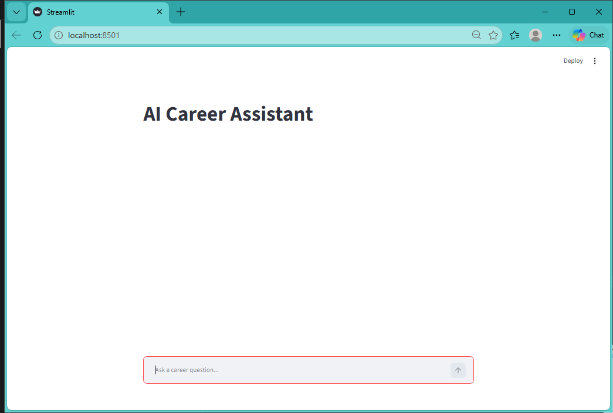
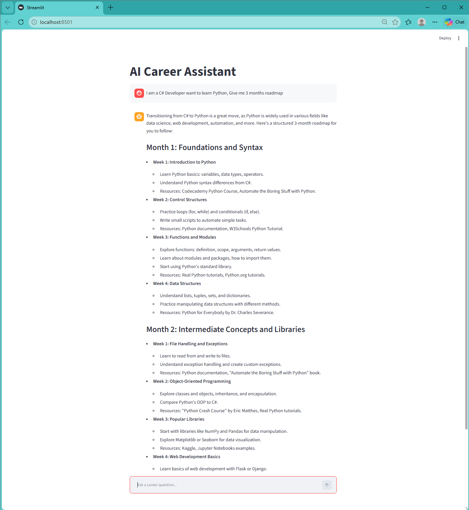
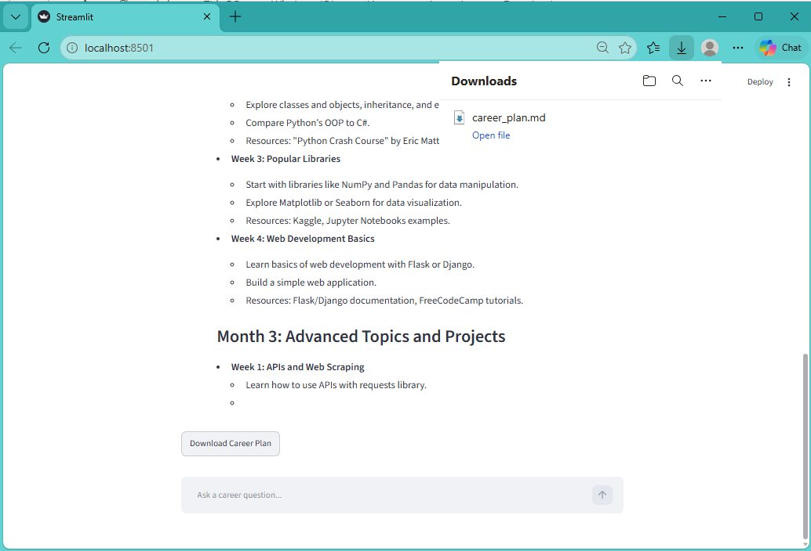
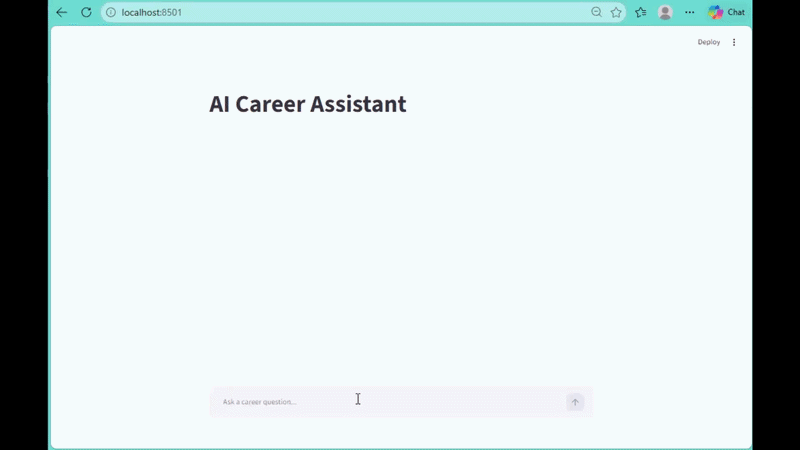

# AI Career Assistant

AI-powered career coaching assistant built using LangChain OpenAI, and Streamlit.

## Features

- Career roadmap generation
- Interactive chat interface
- Conversation memory
- Personalized career Guidance
- Downloadable career plan*(Markdown)

## Tech Stack

- Python
- LangChain
- OpenAI GPT
- Streamlit

## Installation

pip install -r requirements.txt

## Run
streamlit run streamlitChat_app.py

## Home Screen

## Career Guidance Chat

## Download Career Plan

## Demo

